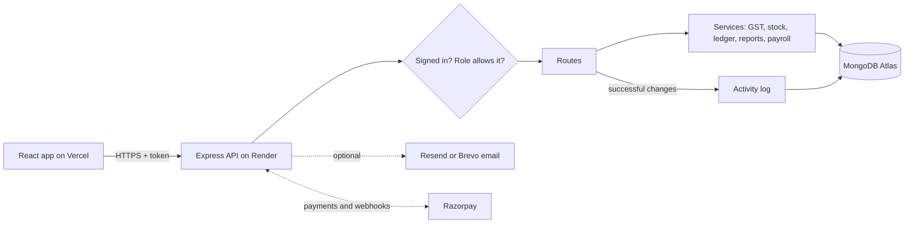

# 📊 GST Invoice App (Full-Stack MERN Application)

A modern, robust, and feature-rich Goods and Services Tax (GST) Invoice Management System. Built using the **MERN** stack (MongoDB, Express, React, Node.js), this application enables businesses to seamlessly generate GST-compliant invoices, track purchases, manage clients (buyers) and inventory (items), mark worker attendance, monitor sales and expenses on a dashboard, and subscribe to paid plans using **Razorpay**.

---

## 🌟 Key Features

### 1. **Sign-in, Team Logins and Security**
- Registration and sign-in with JSON Web Tokens and bcrypt password hashing. People sign in with **email or mobile number** and a password (SMS codes are not used).
- **Team logins** (Growth plan): *billing staff* make bills and take payments but cannot edit or delete them, see costs or profit, or change the bank account on a bill; an *accountant* can read everything and change nothing. Anything not explicitly allowed is refused.
- **Activity log** showing who changed what.
- Password reset by email (when configured); changing a password signs out other sessions.
- Limits on repeated sign-in attempts and on requests overall, refusal of query operators and oversized input, easy passwords refused, security headers and a content security policy, and no internal error details in responses.
- Payments, returns and receipts stay correct when requests arrive at the same moment.
- **UPI QR** for the balance on each unpaid invoice (screen only; the printed bill is unchanged).

### 2. **Home page and Overview**
- Signed-in users open on the **new invoice** screen (an accountant opens the invoice list). The overview is in the menu.
- A public home page at `/` with an animation of a bill being made, the bill designs and the plans.
- **Free bill maker** at `/try`: one bill without an account, to download or share. It runs entirely in the browser.
- Sales, money to collect, money to pay and a GST estimate, with a six-month chart and a list of what needs attention.
- A chat assistant is in the code but **switched off**. To bring it back, set `SHOW_ASSISTANT` in `client/src/lib/flags.js` and `ASSISTANT_ENABLED=true` on the server.

### 3. **GST-Compliant Invoicing**
- Dynamic tax calculation engine:
  - Automatically splits tax into **CGST + SGST** if the Buyer is in the same state as the Seller/Supplier.
  - Applies **IGST** if the Buyer is in a different state.
- Supports HSN/SAC codes, discount structures, and custom GST rates (e.g., 5%, 12%, 18%, 28%).
- Generates the PDF in the browser with `jspdf`, in **four designs**: Classic (`client/src/lib/invoiceLayout.js`) and Modern, Minimal and Elegant (`client/src/lib/themedLayout.js`) in six colours. The home page pictures in `client/src/assets/bills` are printed from `client/src/lib/sampleBill.js`.
- **Bill form in sections:** type, date and number; supplier, buyer, consignee, products, transport, other details, bank, terms and signature.
- Each product line can have its own tax-inclusive setting, discount and CESS. The form (`client/src/lib/gst.js`) and the server (`server/services/gst.js`) are tested to give the same totals.
- **Preview screen** shows the bill itself (drawn with `pdf.js`), with Original, Duplicate and Triplicate copies, print, download, share, payment and a menu for the rest.
- E-invoice and e-way bill numbers can be recorded and printed. The app is **not** connected to the government portals.

### 4. **Purchase & Input Tax Credit (ITC) Tracking**
- Record business purchases from suppliers/sellers.
- Auto-calculate input tax credit available to offset GST liability.
- Upload/record invoice dates, reference numbers, and payment status.

### 5. **Client & Inventory Management**
- **Buyers Database**: Store business name, GSTIN, billing address, state, state code, and contact information.
- **Items (Inventory) Database**: Record product/service names, description, HSN/SAC codes, base prices, units, and default GST rates.

### 6. **Subscription Management (Razorpay Integration)**
- Three plans, billed monthly or yearly. They are defined in `server/services/seedPlans.js`; raise `VERSION` there after changing one.

| Plan | Monthly | Yearly | Invoices a month | Buyers | Products |
| :--- | :--- | :--- | :--- | :--- | :--- |
| Free | ₹0 | ₹0 | 20 | 10 | 10 |
| Starter | ₹499 (regular ₹699) | ₹4,999 | 100 | 50 | 50 |
| Growth | ₹799 (regular ₹1,299) | ₹7,999 | Unlimited | Unlimited | Unlimited, with team logins |

- The regular price is shown struck out as a launch offer. Show it only if you will charge it when the offer ends; set `listPrice` equal to `price` to remove it.
- Live Razorpay checkout integration with secure webhook handling to sync subscription states.

---

## 🛠️ Technology Stack

| Component | Technology | Description |
| :--- | :--- | :--- |
| **Frontend** | React 18, Vite | High-performance single page application framework |
| **Styling** | Tailwind CSS | Utility-first CSS framework for clean, modern, responsive UI |
| **Routing** | React Router Dom v7 | Client-side routing for seamless navigation |
| **Icons & Alerts** | Lucide React, React Hot Toast | Modern icon pack and sleek notification system |
| **PDF Generation** | jsPDF, jsPDF-autotable | Client-side dynamic PDF formatting and downloading |
| **Backend API** | Node.js, Express.js | Fast, minimalist web framework for RESTful APIs |
| **Database** | MongoDB, Mongoose ODM | Document-based database for flexible schemas |
| **Payments** | Razorpay SDK | Payment gateway integrations and webhook sync |

---

## 📁 Repository Structure

```text
gst-invoice-app/
├── client/                 # React Frontend (Vite)
│   ├── src/
│   │   ├── api/            # Axios API client setup and hooks
│   │   ├── assets/         # Static assets (logos, images)
│   │   ├── components/     # Reusable layout components (Sidebar, Navbar)
│   │   ├── context/        # AuthContext and SubscriptionContext
│   │   ├── pages/          # Application views (Dashboard, Invoices, Pricing, etc.)
│   │   ├── App.jsx         # App routes and main rendering
│   │   └── main.jsx        # App entry point
│   ├── package.json        # Frontend dependencies & scripts
│   └── tailwind.config.js  # Styling configurations
│
└── server/                 # Express Backend API
    ├── middleware/         # Auth verify token, rate limiting, plan check
    ├── models/             # Mongoose schemas (User, Invoice, Purchase, Seller, etc.)
    ├── routes/             # REST API endpoints (auth, invoices, buyers, subscriptions...)
    ├── index.js            # Express server entry point & configuration
    └── package.json        # Backend dependencies & scripts
```

---

### 7. **Day-to-day business tools**
- **Quotations** on the same printed format, converted to an invoice in one click.
- **Edit and duplicate** invoices; **sales returns** as credit notes.
- **Party statements** with PDF and CSV, opening balances, credit limits, and one receipt spread over the oldest bills.
- **Stock** worked out from opening count, purchases, sales, returns and adjustments, with low-stock warnings.
- **Worker attendance**: present, half day, absent or leave; daily wage or monthly salary worked out, with advances and payments.
- **Reports**: party-wise and product-wise sales and purchases, GST sales and purchase reports, GSTR-1, GSTR-2 and GSTR-3B working sheets, current stock, and debtor and creditor ledgers, each with CSV export.
- **Expenses**, an estimated **profit** report, **day book**, and **GSTR-1 / GSTR-3B working sheets** (not a filed return).
- **CSV import** of buyers and products, full JSON **backup**, quick search with Ctrl+K.

---

## 🧱 How It Fits Together



Design decisions worth knowing:

- **Stock is calculated** from the opening count, purchases, sales, returns and adjustments, so it cannot drift from the records.
- **Money updates use optimistic concurrency**: if a record changed after it was read, the step runs again on the new copy. Receipts and returns, which touch several records, take a short database lock.
- **Invoice numbers** are protected by a unique index; a request that collides waits briefly and takes the next number.
- **Permissions live in one table** (`server/services/permissions.js`). The sign-in check enforces it, and the screens are told the same answers.
- **Request limits are kept in memory**, so they restart with the server and apply to each server separately.

---

## 🧪 Tests

```bash
cd server && npm test    # API tests against a temporary database
cd client && npm run lint && npm test && npm run build
```

The server tests download a MongoDB binary the first time. To use one you already have, set `MONGOMS_SYSTEM_BINARY` to the path of `mongod`. GitHub Actions runs all of these on every push.

---

## ⚙️ Installation & Setup

### Prerequisites
- [Node.js](https://nodejs.org/) installed (v18+ recommended)
- [MongoDB Atlas](https://www.mongodb.com/cloud/atlas) or a local MongoDB instance
- [Razorpay Account](https://razorpay.com/) (for subscription testing - Test Mode keys)

### 1. Clone the Repository
```bash
git clone https://github.com/your-username/gst-invoice-app.git
cd gst-invoice-app
```

---

### 2. Backend Configuration (`server/`)
Navigate into the `server` directory and install dependencies:
```bash
cd server
npm install
```

Create a `.env` file in the `server/` directory:
```env
# Server Port
PORT=5000

# Database URI
MONGO_URI=your_mongodb_connection_string

# JWT Configurations
JWT_SECRET=your_jwt_strong_secret_key
JWT_EXPIRES_IN=7d

# Razorpay API Credentials
RAZORPAY_KEY_ID=rzp_test_yourKeyId
RAZORPAY_KEY_SECRET=yourSecretKey
RAZORPAY_WEBHOOK_SECRET=yourWebhookSecretString

# Frontend address allowed to call the API in production
CLIENT_URL=

# Password reset by email. Use Resend (needs your own domain) or Brevo (a
# verified sender address is enough). CLIENT_URL must be set as well.
RESEND_API_KEY=
BREVO_API_KEY=
MAIL_FROM=
```

On a host such as Render, do **not** set `PORT`; the host provides it.

Business details (name, GSTIN, bank account, logo, signature, invoice number prefix) are set by each user on the Settings page.

Start the backend server:
```bash
# Run in development mode (with nodemon reload)
npm run dev

# Run in production mode
npm start
```
The API server will run at [http://localhost:5000](http://localhost:5000).

---

### 3. Frontend Configuration (`client/`)
Open a new terminal, navigate to the `client` directory, and install dependencies:
```bash
cd client
npm install
```

Create a `.env` file in the `client/` directory:
```env
VITE_API_URL=http://localhost:5000/api
```

Start the React development server:
```bash
npm run dev
```
The frontend application will spin up at [http://localhost:5173](http://localhost:5173).

---

## ⚡ API Endpoints Map

### Authentication
- `POST /api/auth/register` — Create a new user profile
- `POST /api/auth/login` — Sign in with `{ login, password }`, where login is an email or mobile number
- `PUT /api/auth/mobile` — Set or remove your sign-in mobile number
- `GET /api/auth/me` — The signed-in person, their role and what they may do
- `POST /api/auth/forgot-password`, `POST /api/auth/reset-password` — Password reset by email
- `GET /api/auth/options` — Whether password reset is available

### Team
- `GET/POST /api/team`, `PUT/DELETE /api/team/:id` — Team logins (owner only)
- `GET /api/activity?page=` — Activity log (owner only)

### Invoices
- `GET /api/invoices` — List all invoices created by the authenticated user (supports search & filters)
- `POST /api/invoices` — Create a new invoice (checks active plan limits)
- `GET /api/invoices/:id` — View detailed invoice record
- `PUT /api/invoices/:id` — Modify an existing invoice
- `PUT /api/invoices/:id/status` — Change payment status or cancel
- `POST /api/invoices/:id/payment` — Record payment collections
- `GET /api/invoices/next-number` — The number the next invoice would get
- `PUT /api/invoices/:id/compliance` — Save the IRN and e-way bill number from the government portals
- `PUT /api/invoices/:id/signature` — Place a signature image on one invoice (owner)
- `GET /api/invoices/:id/history` — Who changed this invoice
- `DELETE /api/invoices/:id` — Delete an invoice with no payments or credit notes (owner)

### Purchases
- `GET /api/purchases` — View purchase bills (input records)
- `POST /api/purchases` — Record a new purchase entry
- `DELETE /api/purchases/:id` — Delete a purchase entry

### Overview
- `GET /api/insights` — Dues, GST estimate and items needing attention

### Attendance
- `GET /api/workers?month=YYYY-MM` — Workers with their marks, pay and payments
- `POST /api/workers`, `PUT/DELETE /api/workers/:id`
- `PUT /api/workers/attendance` — Mark one day
- `POST /api/workers/:id/payments`, `DELETE /api/workers/:id/payments/:paymentId`

### Sales, stock and reports
- `GET/POST /api/quotations`, `PUT/DELETE /api/quotations/:id`, `POST /api/quotations/:id/convert`
- `GET/POST /api/credit-notes`, `DELETE /api/credit-notes/:id`
- `GET /api/stock`, `GET /api/stock/:itemId/history`, `POST /api/stock/adjust`
- `GET/POST /api/expenses`, `PUT/DELETE /api/expenses/:id`
- `GET /api/ledger/buyer/:id`, `POST /api/ledger/buyer/:id/receive`, `GET /api/ledger/seller/:id`
- `GET /api/reports/summary|sales|purchases|gst|gstr2|daybook?from=YYYY-MM-DD&to=YYYY-MM-DD`
- `GET /api/reports/stock`, `GET /api/reports/outstanding` — current stock, and debtors and creditors, as of now
- `GET /api/data/export`, `POST /api/data/import/buyers|items`, `GET /api/data/search?q=`
- `PUT /api/auth/password`

### Buyers & Items
- `GET/POST /api/buyers` — List or create buyers
- `PUT/DELETE /api/buyers/:id` — Manage specific buyer profile
- `GET/POST /api/items` — List or create inventory products
- `PUT/DELETE /api/items/:id` — Update or delete inventory items

### Subscriptions
- `GET /api/subscriptions/plans` — Fetch active billing tiers
- `POST /api/subscriptions/create-order` — Create Razorpay order for billing
- `POST /api/subscriptions/verify-payment` — Verify signature and activate plan status
- `POST /api/subscriptions/webhook` — Razorpay webhook receiver to sync subscriptions asynchronously

---

## 🧮 GST Calculation Logic

The application calculates GST based on the relative locations of the business and the buyer:
- **Intrastate (Same State)**: If `buyer.stateCode == supplier.stateCode`:
  $$\text{CGST} = \text{Tax Rate} / 2$$
  $$\text{SGST} = \text{Tax Rate} / 2$$
  $$\text{IGST} = 0$$
- **Interstate (Different State)**: If `buyer.stateCode != supplier.stateCode`:
  $$\text{CGST} = 0$$
  $$\text{SGST} = 0$$
  $$\text{IGST} = \text{Tax Rate}$$

This ensures compliance with Indian GST directives and produces accurate tax invoice printouts.

---

## 🛡️ License

This project is open-source and available under the [MIT License](LICENSE).
